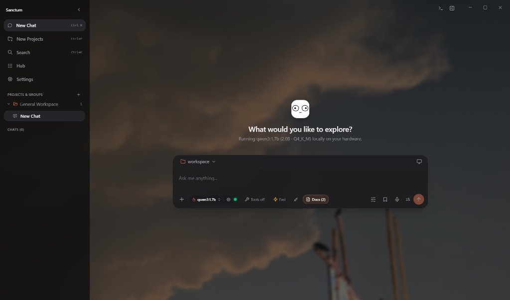

<p align="center">
  
</p>

<h1 align="center">Sanctum</h1>

<p align="center">
  A strictly local, private AI workspace and agent harness for Windows.
</p>

<p align="center">
  <a href="Sanctum.exe">Download Sanctum.exe</a> ·
  <a href="SHA256SUMS">SHA-256</a> ·
  <a href="CAPABILITIES.md">Capabilities</a> ·
  <a href="docs/ARCHITECTURE.md">Architecture</a>
</p>

<p align="center">
  
</p>

---

## Quick Start

1. Download [Sanctum.exe](Sanctum.exe) (on GitHub, click **Download raw file**).
2. Run it — Sanctum unpacks automatically and sets up local Ollama + a starter model on first launch.
3. Chat, attach documents, or pick a local workspace folder directly from the composer.

No Node.js, Python, or terminal setup required. Verify your download against [SHA256SUMS](SHA256SUMS):

```powershell
Get-FileHash .\Sanctum.exe -Algorithm SHA256
```

## Features

- **Local Inference** — Powered by Ollama with per-chat model selection, reasoning toggles, and rich Markdown/code rendering.
- **Independent Split View** — Open any two conversations side-by-side (`... → Open in Split View`), resize panes, and stream simultaneously.
- **Workspace File Tools & Checkpoints** — Choose any local folder from the composer, use **Plan** mode (`PLAN.md` review), inspect per-hunk diffs, and recover deleted files from `tool-trash`.
- **Offline Documents & OCR** — Attach PDFs, DOCX, CSV, JSON, Markdown, and code locally. Scanned PDFs automatically fall back to built-in Windows offline OCR (or optional `PaddleOCR-VL-1.6` sidecar in `core/ai/ocr/`).
- **Local Voice & Browser Agent** — Offline Windows dictation / local STT (`Qwen3-ASR-0.6B`, `Nemotron 3.5`), MCP server connectors, and a sandboxed `browser-use` agent with domain allowlists.
- **System Monitor & Logs** — Live Windows CPU/RAM/GPU usage, self-updater, and local JSONL logs in Settings.

## Build from Source

Requires Windows, Node.js 22+, Python 3.10+, and .NET Framework C# compiler:

```powershell
npm ci
python tools/build_installer.py
python tools/package_distribution.py
```

### Dev Checks

```powershell
npm run typecheck
npm run lint
npm test
npm run build
```

## License

MIT — see [LICENSE](LICENSE) and [THIRD_PARTY_NOTICES.txt](THIRD_PARTY_NOTICES.txt).
