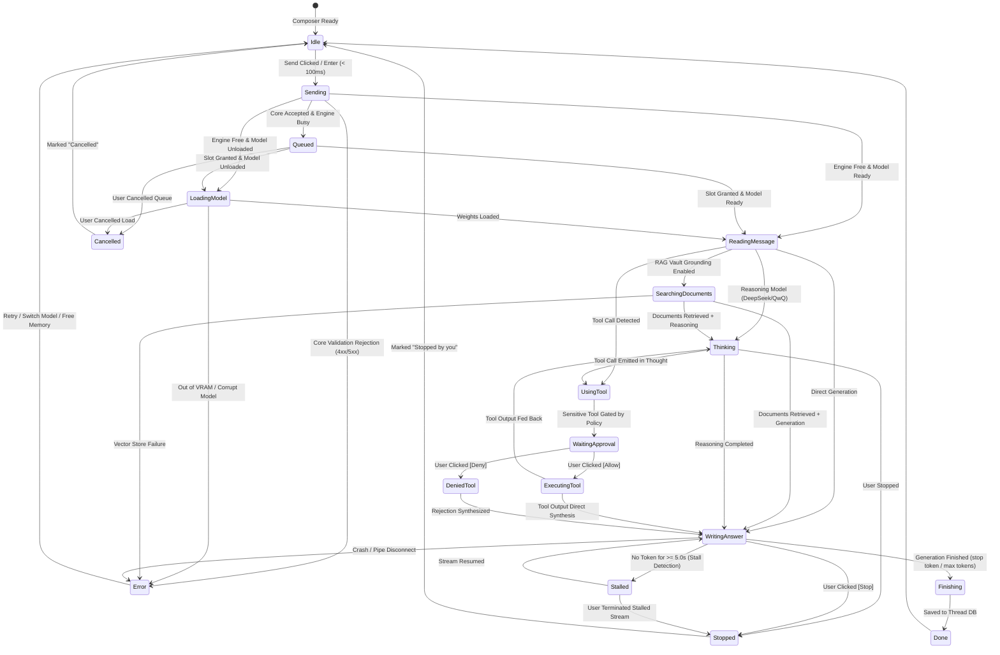

# Sanctum Interaction Specification: Live Request Status & Micro-Interactions

> [!IMPORTANT]
> **Owner Authorization**: Added under AMENDMENT 1 (`docs/MASTER_PROMPT.md`).
> Authorizes new UI/UX elements that provide live status for prompt processing and smoother interactive feedback.
> Core mandate: Real data only (never fake/simulated), honest feedback, quiet design tokens, zero idle animation overhead, toggleable per element via Settings.

---

## 1. State Diagram of the Request Lifecycle



---

## 2. Event Contract: `request.status`

The core gateway emits Server-Sent Events (SSE) or WebSocket packets over the local loopback connection adhering to this exact schema:

```typescript
export type RequestPhase =
  | "sending"
  | "queued"
  | "loading_model"
  | "reading_message"
  | "searching_documents"
  | "thinking"
  | "using_tool"
  | "waiting_approval"
  | "writing_answer"
  | "finishing"
  | "done"
  | "stopped"
  | "cancelled"
  | "stalled"
  | "error";

export interface RequestStatusProgress {
  current: number;
  total: number;
  unit?: "tokens" | "bytes" | "docs" | "steps" | "percent";
  percentage?: number; // 0..100 (only when supplied by engine)
}

export interface RequestStatusEvent {
  request_id: string;
  thread_id: string;
  message_id: string;
  phase: RequestPhase;
  timestamp: number; // Unix ms
  elapsed_ms: number; // Monotonic elapsed time
  progress?: RequestStatusProgress;
  detail?: string; // e.g. model name, tool name, queue position
  stats?: {
    tokens_generated?: number;
    tokens_per_second?: number;
    prompt_tokens?: number;
    context_total?: number;
    time_to_first_token_ms?: number;
    total_time_ms?: number;
  };
  tool_call?: {
    id: string;
    name: string;
    args_summary: string;
    risk_level: "low" | "medium" | "high";
    gated: boolean;
  };
  error?: {
    code: string;
    message: string;
    recovery_actions: ("retry" | "switch_model" | "free_memory" | "open_settings")[];
  };
}
```

---

## 3. Exact Copy & Microcopy Table

Every phase renders concise, truthful microcopy using monospace tokens for metrics:

| Phase | Display Text / Template | Action Controls | Microcopy Rules |
| :--- | :--- | :--- | :--- |
| **1. Sending** | `Sending message...` | *(None)* | Optimistic render of user message with subtle pulse. Transitions in < 100ms. |
| **2. Queued** | `Queued #<pos> in <lane> lane (<elapsed>s)` | `[Cancel]` | Position from real admission controller. No fake estimated wait unless measured. |
| **3. Loading model** | `Loading <model_name> (<pct>% • <elapsed>s)` | `[Cancel]` | Percentage shown ONLY if engine emits progress; otherwise `Loading <model_name> (<elapsed>s)`. |
| **4. Reading message** | `Processing prompt (<curr>/<total> tokens • <elapsed>s)` | `[Cancel]` | Real prompt evaluation count from engine. |
| **5. Searching documents** | `Searching Vault (found <count> passages in <docs> files)` | *(None)* | Appears only when RAG toggle is active and search is running. Citations chip in. |
| **6. Thinking** | `Thinking (<elapsed>s)...` | `[Collapse/Expand]` `[Stop]` | Shows live thoughts stream. Real reasoning models only (think tags). |
| **7. Using a tool** | `Running <tool_name>(<args>) • <elapsed>s` | `[Stop]` | Compact mono chip with running elapsed timer. |
| **7b. Waiting approval** | `Action requires authorization: <tool_name>` | `[Allow]` `[Deny]` | High-contrast security boundary card. Cannot be styled away by themes. |
| **8. Writing answer** | `<tok_per_sec> tok/s • <count> tokens • <elapsed>s` | `[Stop]` | Real calculated speed and token count. Persistent red Stop button. |
| **8b. Stalled** | `No response for <elapsed>s` | `[Wait]` `[Stop]` | Triggered after 5.0s without SSE event. Yellow status indicator. |
| **9. Finishing** | `Saving response...` | *(None)* | SQLite / JSON write flush. |
| **10. Done** | `<total_toks> tokens in <time>s (<speed> tok/s) • <ctx> ctx` | `[Details ▾]` | Collapsible metadata footer beneath assistant message. |
| **11. Stopped** | `Generation stopped by user after <count> tokens` | `[Regenerate]` | Soft amber indicator. Partial text preserved. |
| **12. Error** | `<error_message>` | `[Retry]` `[Switch Model]` | Actionable buttons mapped to typed error code. |

---

## 4. Timings, Budgets & Thresholds (ADR 0102 Pre-sets)

- **UI Acknowledgement**: User click to first state change visible: **$\le$ 100 ms** (p95).
- **Stall Detection Threshold**: No tokens received for **5.0 s** triggers `stalled` state with `[Wait]` and `[Stop]` options.
- **Micro-Interaction Motion**: All transitions **120 ms to 200 ms** ease-out (`cubic-bezier(0.16, 1, 0.3, 1)`).
- **Reduced Motion**: When `prefers-reduced-motion: reduce` is detected:
  - 0ms transform / position transitions.
  - No pulse or continuous rotation.
  - Text and status indicators remain 100% visible and functional.
- **ARIA Announcement**: Polite announcements on phase changes only (`aria-live="polite"`). Never announce individual token ticks.

---

## 5. Visual Frame Mockups (ASCII Wireframes)

### State 1: Prompt Accepted & Queued
```
┌──────────────────────────────────────────────────────────────┐
│ [User Avatar] Aviroop                                        │
│ Can you benchmark the quantization levels for DeepSeek-R1?   │
└──────────────────────────────────────────────────────────────┘
┌──────────────────────────────────────────────────────────────┐
│ [Sanctum Avatar]                                             │
│ ⟳ Queued #1 in chat lane (1.2s) • [Cancel]                   │
└──────────────────────────────────────────────────────────────┘
```

### State 2: Model Loading (Weights Reading)
```
┌──────────────────────────────────────────────────────────────┐
│ [Sanctum Avatar]                                             │
│ ⟳ Loading DeepSeek-R1-Distill-Qwen-7B (44% • 2.8s) • [Cancel]│
│ [██████████████░░░░░░░░░░░░░░░░░░░░]                         │
└──────────────────────────────────────────────────────────────┘
```

### State 3: Document Retrieval (RAG)
```
┌──────────────────────────────────────────────────────────────┐
│ [Sanctum Avatar]                                             │
│ 🔍 Searching Vault (found 4 passages in 2 files • 0.3s)       │
│ [📄 benchmark_notes.md#L12] [📄 quant_spec.pdf#p3]           │
└──────────────────────────────────────────────────────────────┘
```

### State 4: Reasoning Model "Thinking" Live Collapsible View
```
┌──────────────────────────────────────────────────────────────┐
│ [Sanctum Avatar]                                             │
│ 🧠 Thinking (4.2s) ▾                                         │
│ ┌──────────────────────────────────────────────────────────┐ │
│ │ The user wants a comparison of Q4_K_M vs Q8_0 latency... │ │
│ │ Checking llama.cpp perplexity tables for 7B models...    │ │
│ └──────────────────────────────────────────────────────────┘ │
│                                                              │
│ [Stop Generating]                                            │
└──────────────────────────────────────────────────────────────┘
```

### State 5: Generating Answer (Live Streaming Stepper)
```
┌──────────────────────────────────────────────────────────────┐
│ [Sanctum Avatar]                                             │
│ When comparing quantization tiers for local inference,       │
│ memory bandwidth is the primary bottleneck...▌              │
│                                                              │
│ ───────────────────────────────────────────────────────────  │
│ ⚡ 22.4 tok/s • 86 tokens • 3.8s              [■ Stop]       │
└──────────────────────────────────────────────────────────────┘
```

### State 6: Completed Response (Done Stats Popover)
```
┌──────────────────────────────────────────────────────────────┐
│ [Sanctum Avatar]                                             │
│ ...summary of recommendations for your hardware.             │
│                                                              │
│ ✓ 248 tokens in 11.2s (22.1 tok/s) • 2,410 ctx  [Details ▾] │
└──────────────────────────────────────────────────────────────┘
```

---

## 6. Two Critique Rounds

### Critique Round 1: Density & Clutter Analysis
- **Finding**: Having progress bars and stepper circles under the message adds excessive visual height, cluttering long chat transcripts.
- **Remedy**: Collapse the status into a single sleek inline status pill directly beneath the assistant bubble with height $\le$ 28px. Step history is available on hover or click, not permanently taking up vertical rhythm.

### Critique Round 2: Accessibility & Resource Impact
- **Finding**: Emitting ARIA live messages on every token would overwhelm screen readers and trigger continuous DOM layout recalculations.
- **Remedy**: Lock the live region strictly to discrete phase transitions (`aria-live="polite"`). Rate-limit token metric visual updates to requestAnimationFrame (RAF), decoupling display refreshes from internal SSE network chunks.

---

## 7. Proposed Smoothness Elements (Section 3 Priority Queue)

1. **Slice 1 (Immediate)**: Request Lifecycle Status line (Phases 1–10, event stream, inline stepper, stall detection, Stop/Cancel).
2. **Slice 2**: Streaming Polish & Smooth Scroll (RAF token batching, zero layout shift, stick-to-bottom with "Jump to latest" pill, live token counter).
3. **Slice 3**: Optimistic UI & Local Feedback (instant thread rename, delete with undo toast, skeleton loader delayed 150ms).
4. **Slice 4**: Composer Interactivity (draft preservation in SQLite/core DB across crashes, token estimator, model warm-up on focus toggle).
5. **Slice 5**: Optional Resource HUD (toggle in Interface settings, real RAM, VRAM, CPU, tokens/s overlay).
