# Current Architecture & Dependency Graph (R0.d)

```mermaid
graph TD
  subgraph Frontend UI
    ChatScreen[src/components/screens/ChatScreen.tsx]
    ArenaScreen[src/components/screens/ArenaScreen.tsx]
    VaultScreen[src/components/screens/VaultScreen.tsx]
    ModelsScreen[src/components/screens/ModelsScreen.tsx]
    ResearchScreen[src/components/screens/ResearchScreen.tsx]
    WelcomeModal[src/components/onboarding/WelcomeModal.tsx]
  end

  subgraph State / Store
    ZustandStore[src/store/useAppStore.ts]
    ChatSlice[src/store/slices/chatSlice.ts]
    ModelsSlice[src/store/slices/modelsSlice.ts]
    RagSlice[src/store/slices/ragSlice.ts]
    ArenaSlice[src/store/slices/arenaSlice.ts]
    ResearchSlice[src/store/slices/researchSlice.ts]
  end

  subgraph Core Library
    EngineClient[src/lib/engine.ts]
    VectorStore[src/lib/vectorStore.ts]
    Constants[src/lib/constants.ts]
  end

  subgraph Next.js API Routes
    ApiOllamaModels[src/app/api/ollama/models]
    ApiOllamaPull[src/app/api/ollama/pull]
    ApiAudioTranscribe[src/app/api/audio/transcribe]
    ApiAudioWhisperx[src/app/api/audio/whisperx]
  end

  ChatScreen --> ZustandStore
  ChatScreen --> EngineClient
  ArenaScreen --> ZustandStore
  ArenaScreen --> EngineClient
  VaultScreen --> ZustandStore
  VaultScreen --> VectorStore
  ModelsScreen --> ZustandStore
  ModelsScreen --> Constants
  WelcomeModal --> ZustandStore
  WelcomeModal --> Constants

  ZustandStore --> ChatSlice
  ZustandStore --> ModelsSlice
  ZustandStore --> RagSlice
  ZustandStore --> ArenaSlice
  ZustandStore --> ResearchSlice

  ChatSlice --> EngineClient
  ChatSlice --> VectorStore
  ModelsSlice --> EngineClient
  RagSlice --> VectorStore

  ApiOllamaModels --> Constants
  ApiOllamaPull --> Constants
  ApiAudioTranscribe --> Constants
  ApiAudioWhisperx --> Constants
```

---

## Audit: AI/Business Logic Located in UI Components

The following violations must be extracted into `core/ai`, `contracts/`, or `api-client/`:

1. **`src/components/screens/ChatScreen.tsx`**:
   - **Reasoning Regex Splitter**: `<think>([\s\S]*?)(<\/think>|$)` defined directly in UI presentation layer. Should be in `core/ai/inference/format.ts`.
   - **Default Prompt Construction**: Fallbacks (`"Please analyze this image."`, `"Please analyze the attached document."`) embedded in button callbacks. Should be in `core/ai/prompts/`.
   - **MIME & Document Type Parsing**: File extension mapping (`.md`, `.pdf`, `.json`, `.ts`) directly in UI. Should be in `core/domain/documents.ts`.
   - **MediaRecorder & Web Speech API Logic**: Audio recording, chunks assembly, and WhisperX endpoint dispatch embedded directly in React component. Should live in a dedicated speech client port.

2. **`src/components/screens/ArenaScreen.tsx`**:
   - **Multi-Model Inference Loop**: Direct iteration over panes with streaming execution and latency math embedded in UI buttons. Should be encapsulated in an `ArenaRunner` domain service.
   - **Benchmark Prompts**: Raw benchmark prompt strings hardcoded in UI selection handlers.

3. **`src/components/screens/ResearchScreen.tsx`**:
   - **Wikipedia Retrieval & Synthesis Pipeline**: UI component directly coordinates HTTP searches, creates research steps, and synthesizes citations. Should live in `packs/research/` or `core/ai/research/`.

4. **`src/components/screens/AgentsScreen.tsx`**:
   - **Hardcoded Task Prompts & Steps**: String constants for agent checkout simulation in UI markup.

5. **`src/components/onboarding/WelcomeModal.tsx` & `src/components/screens/ModelsScreen.tsx`**:
   - **Model Catalog Heuristics**: Heuristic classification of model names (e.g. `m.name.includes("qwen")`) in UI logic.
   - **Hardware Telemetry Formatting**: Raw VRAM math and accelerator heuristics mixed into display tags.
